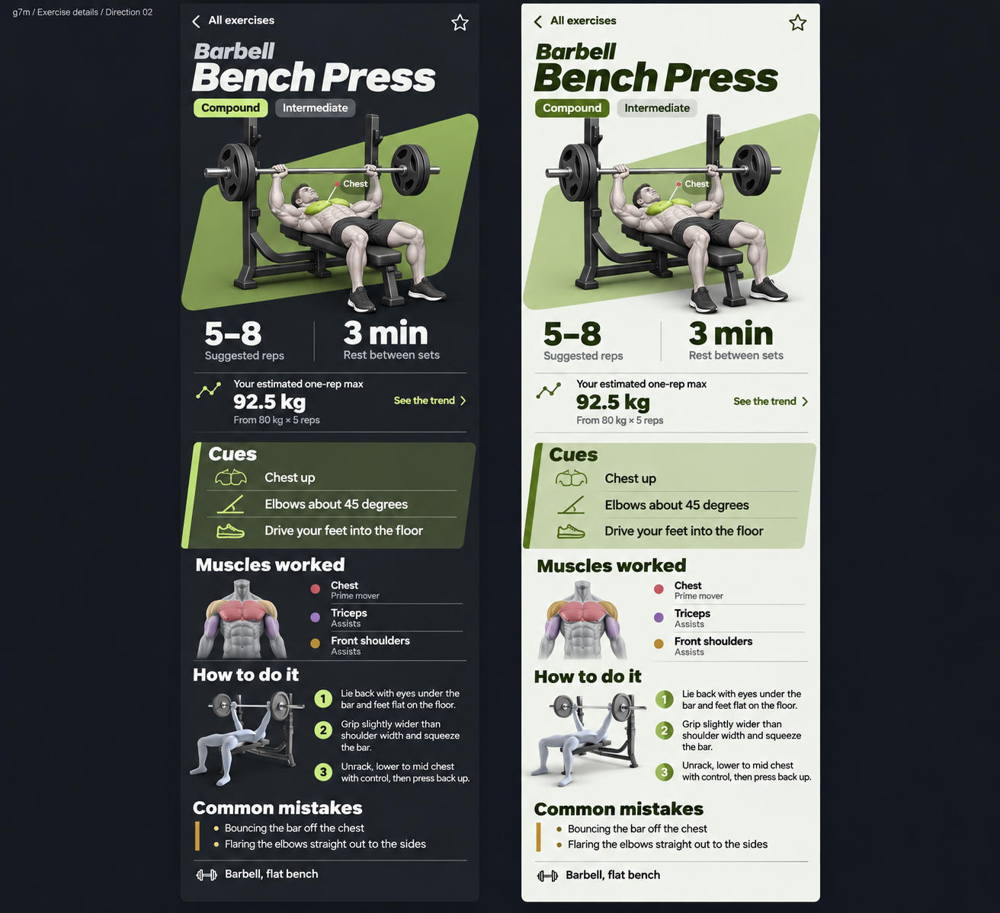

# Exercise details — approved Direction 02

Milan approved this generated concept on 7 November 2026. It is the visual
reference for the exercise-details redesign, not application data. The example
92.5 kg estimate and 80 kg × 5 source are illustrative; the app continues to
calculate estimates from the account's actual history.

The design retains g7m's graphite and green tokens and Inter typography, with a
bold italic exercise title, complete exercise illustration over an angled sage
stage, compact training facts, green coaching cues and recruitment-colored muscles.
Instructions, common mistakes and equipment use open sections instead of a
repeating stack of identical cards. All cues and instructions remain visible.

The implementation adapts this reference to real catalogue content and mobile
accessibility: long names wrap naturally, all existing muscle rows remain,
front/back anatomy views cover posterior and lower-body exercises, and the
demonstration keeps its original media backgrounds and adds a pause control.
The anatomy preview renders only as its section approaches the viewport and
cannot intercept scrolling. Timed holds and cardio retain their own labels.

Original exercise artwork is preserved. High-resolution WebP copies load per
exercise, with the already-cached thumbnails as offline fallbacks. No schema,
catalogue or sync-rule changes are part of this redesign.

The 8 November refinement puts a labelled Favourite button below the title,
joins the cue card's green border to its background, and uses Learn's heat
palette for the body and muscle bars: stronger recruitment is redder.
