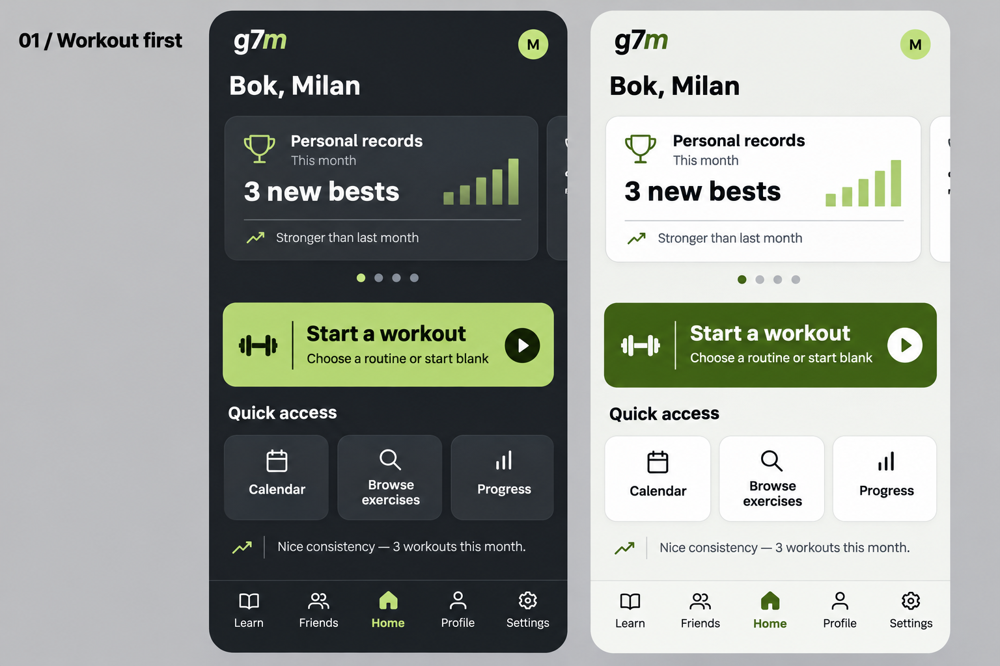
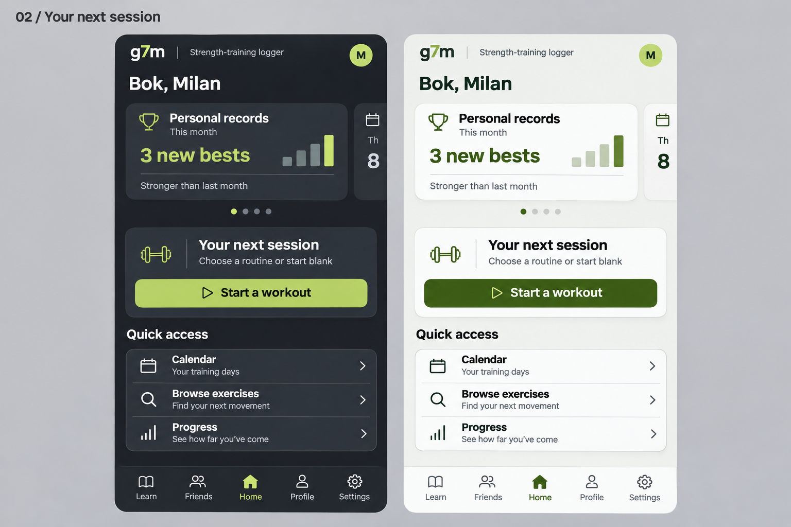
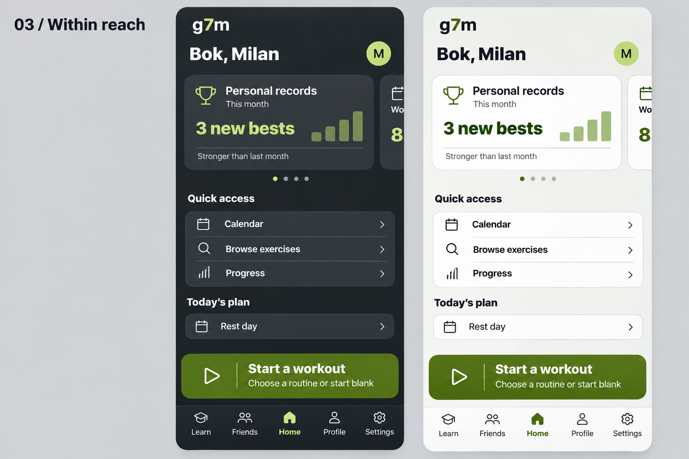

# Home screen mockup concepts

Generated design explorations, 9 November 2026. These images are proposals, not implemented app screenshots.

The brief: keep all four month stat cards, refine Quick access, and make **Start a workout** more visible and purposeful.

All three concepts retain the horizontal four-card carousel: Personal records, Workouts, Muscle groups, and Strength & activity. Each image shows its first slide, the next card's edge, and four pagination marks. Both light and dark themes appear in every board.

| Concept | Workout action | Quick access |
| --- | --- | --- |
| [01: Workout first](01-workout-first.png) | Full-width primary action directly below the stat carousel, with the explanation “Choose a routine or start blank” | Three compact tiles: Calendar, Browse exercises, Progress |
| [02: Your next session](02-session-panel.png) | Dedicated session panel with explanation and a full-width start button | Three rows with icons and descriptions |
| [03: Within reach](03-thumb-zone.png) | Persistent start action immediately above the bottom tab bar | Three compact navigation rows |

**Recommended starting point:** concept 01 gives starting a workout the clearest visual priority while keeping the screen compact. Concept 03 prioritizes thumb reach and continued visibility as the page scrolls.

The concepts use the existing graphite, volt and deep-green tokens and Inter typography as references. Generated illustrations can approximate spacing, color and icon details; implementation should use the exact existing components and tokens. Example training figures and observations are illustrative. Any eventual implementation must retain offline behavior, the current routine/blank chooser, the resume-workout state, optional coaching, accessible controls, and reduced-motion support. Today's plan remains conditional on workout recommendations.

## Images

## Generation

Created with the built-in image generation tool, using one prompt per concept. Full final prompts are in [prompts.md](prompts.md).

Validation: visually inspected all three boards for readable start actions, the four-slide carousel indicator, the three navigation shortcuts, both themes, and tab-bar clearance. No application code was changed, so application tests were not run.

PowerSync: no updated sync rules or dashboard deployment required.

Database: no migrations; `npx supabase db push` is not required.

